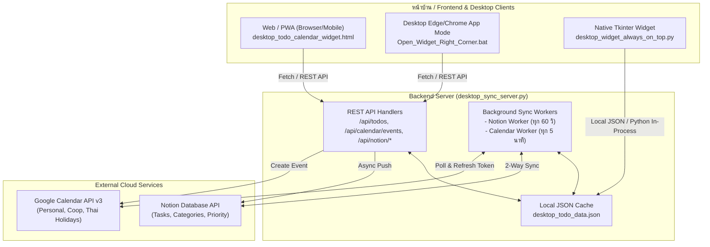

# รายงานรีวิวระบบและคู่มือส่งต่องาน (Project Review & Handover Guide for Argon)
**โปรเจกต์:** `Pattara02523/todo-calendar-cloud-widget`  
**สถานะปัจจุบัน:** ดึงโค้ดลงมาในพื้นที่ทำงานแล้ว (`/home/antigravity/todo-calendar-cloud-widget`) พร้อมส่งมอบให้ **Argon** นำไปต่อยอดและพัฒนาต่อได้ทันที

---

## 1. ภาพรวมโปรเจกต์ (Executive Summary)

โปรเจกต์นี้เป็น **Hybrid To-Do List & Google Calendar Widget** ที่ออกแบบมาเพื่อการใช้งานแบบ Always-on ทั้งบน Desktop (หน้าจอคอมพิวเตอร์) และบนระบบคลาวด์ (Cloud Web App / PWA)

### จุดเด่นหลักของระบบ:
1. **2-Way Synchronization กับ Notion Database:**
   - เชื่อมต่อกับ Notion API เพื่อดึงและอัปเดตงาน (Tasks) แบบ 2 ทิศทางอัตโนมัติ
   - ตรวจจับการเปลี่ยนแปลง (สร้างใหม่, ติ๊กถูกเสร็จงาน, ลบ/Archive) และซิงก์กลับขึ้น Notion ทันที
2. **Real-time 1-Week Google Calendar Integration:**
   - ดึงปฏิทินงานสดล่วงหน้า 1 สัปดาห์ (ครอบคลุมปฏิทินส่วนตัว, สหกรณ์, และวันหยุดไทย)
   - รองรับการสร้างนัดหมายใหม่ลง Google Calendar ได้จากหน้า Widget โดยตรง
3. **Multi-Platform Deployment & Access:**
   - **Cloud Web Server:** ทำงานบน Docker / Render / Heroku / Railway ผ่าน `desktop_sync_server.py`
   - **Desktop Standalone Mode:** เปิดผ่าน Chrome/Edge ในโหมด `--app` ลอยชิดมุมขวาของหน้าจอ (`Open_Widget_Right_Corner.bat`)
   - **Native Desktop Python Widget:** รัน Tkinter GUI ล็อกสถานะ `Always on Top` (`desktop_widget_always_on_top.py`)
4. **Zero Pip Dependency:**
   - ตัว Backend เขียนด้วย Python Standard Library 100% (`http.server`, `urllib.request`, `json`, `threading`, `socketserver`) ไม่ต้องติดตั้งแพ็กเกจภายนอก

---

## 2. โครงสร้างไฟล์และสถาปัตยกรรม (Architecture & File Map)

```
todo-calendar-cloud-widget/
├── .calendar_auth/                       # ⚠️ ไฟล์ Credential ของ Google OAuth
│   ├── credentials.json                  # Tokens (access_token, refresh_token)
│   └── gcp-oauth.keys.json               # Client ID & Client Secret
├── desktop_todo_calendar_widget.html     # Frontend UI หลัก (Tailwind CSS, Glassmorphism, PWA)
├── desktop_sync_server.py                # Backend Server (HTTP Server, REST API, Background Workers)
├── notion_service.py                     # Service จัดการ Notion API (Sync 2 ทาง, Query, CRUD)
├── google_calendar_service.py            # Service จัดการ Google Calendar API (OAuth refresh, Query, Create)
├── desktop_widget_always_on_top.py       # Native GUI (Tkinter) สำหรับ Desktop Docked Widget
├── desktop_todo_data.json                # Local Cache สำหรับเก็บ Tasks และ Calendar Events
├── notion_config.json                    # ⚠️ การตั้งค่า Notion Token และ Database ID
├── manifest.json                         # PWA Manifest สำหรับ Add to Home Screen
├── render.yaml                           # Blueprint สำหรับ Deploy ขึ้น Render.com
├── Dockerfile                            # Docker image (python:3.12-slim)
├── Procfile                              # Web process configuration (Railway/Heroku)
├── requirements.txt                      # รายการ dependency (ปัจจุบันใช้ pure standard library)
├── Open_Widget_Right_Corner.bat          # สคริปต์เปิด Web Widget ชิดมุมขวาจอ Windows
├── Run_Python_Widget.bat                 # สคริปต์เปิด Tkinter Widget
├── Install_Python_Widget_Startup.bat     # สคริปต์ลงทะเบียน Desktop Shortcut & Windows Startup
└── README_วิธีใช้งาน.txt                   # คู่มือภาษาไทยเบื้องต้น
```

### แผนภาพการไหลของข้อมูล (Data Flow Diagram)



---

## 3. การทำงานของระบบ Backend & Services

### 3.1 `desktop_sync_server.py`
- ให้บริการ HTTP REST API แบบ Multi-threaded (`ThreadedHTTPServer`)
- กำหนด Port ผ่าน Environment Variable `PORT` (Default: `18234` บนเครื่อง Local, `10000` บน Render)
- รองรับ CORS Header ครบถ้วน เพื่อให้ Frontend เรียกใช้งานได้ทั้งแบบ `file://` และผ่าน Origin โดเมนออนไลน์
- **Background Workers:**
  - `background_notion_sync_worker`: ทำงานทุก 60 วินาที ตรวจสอบการอัปเดตจาก Notion Database
  - `background_calendar_sync_worker`: ทำงานทุก 5 นาที (300 วินาที) ดึงนัดหมาย Google Calendar ล่าสุด

### 3.2 `notion_service.py`
- ทำงานผ่าน Notion API เวอร์ชั่น `2022-06-28`
- มีฟังก์ชัน Auto-discovery: ตรวจสอบหา Database หรือ Page ที่บอท `ICT` เข้าถึงได้อัตโนมัติ
- หากส่งไปยังหน้าว่าง (Page) ระบบสามารถสร้างโครงสร้างตารางงาน (`Task`, `Done`, `Due Date`, `Priority`, `Category`) ให้เองอัตโนมัติ
- รองรับการแปลงสถานะ Checkbox และ Select Options

### 3.3 `google_calendar_service.py`
- จัดการ Token Lifecycle: ตรวจสอบ `access_token` หากหมดอายุจะส่ง `refresh_token` ไปขอ token ใหม่จาก Google OAuth Endpoint อัตโนมัติ
- รองรับการอ่านและจัดเรียงนัดหมายจาก 3 ปฏิทินพร้อมกัน:
  - `pattarapon.thongsri@gmail.com` (ส่วนตัว)
  - `coopthaiict@gmail.com` (สหกรณ์)
  - `en.th#holiday@group.v.calendar.google.com` (วันหยุดไทย)
- คำนวณช่วงเวลา Timezone ประเทศไทย (`+07:00` / `Asia/Bangkok`) ทั้งกิจกรรมระบุเวลาและกิจกรรมทั้งวัน (All-day events)

---

## 4. 🚨 ข้อควรระวังด้านความปลอดภัยและจุดบกพร่องที่ต้องแก้ไขเร่งด่วน (Critical Issues for Argon)

> [!CAUTION]
> **1. มี Secret และ Credential จริงหลุดอยู่ใน Git Repository!**
> - ในไฟล์ [notion_config.json](file:///home/antigravity/todo-calendar-cloud-widget/notion_config.json) และ [notion_service.py](file:///home/antigravity/todo-calendar-cloud-widget/notion_service.py#L33) มี **Notion Token จริง (`ntn_T616821703...`)** ฝังอยู่
> - ในโฟลเดอร์ [.calendar_auth/](file:///home/antigravity/todo-calendar-cloud-widget/.calendar_auth) มี **Google OAuth Refresh Token และ Client Secret จริง**
> - ใน [.gitignore](file:///home/antigravity/todo-calendar-cloud-widget/.gitignore) ไม่ได้ระบุละเว้นไฟล์ `.calendar_auth/` หรือ `notion_config.json`
> 
> **สิ่งที่ Argon ต้องดำเนินการทันที:**
> 1. เพิกถอน (Revoke) และสร้าง Token ใหม่ใน Notion และ Google Cloud Console
> 2. เพิ่ม `.calendar_auth/`, `notion_config.json`, และ `desktop_todo_data.json` ลงใน `.gitignore`
> 3. บังคับใช้การอ่าน Credential ผ่าน Environment Variables หรือไฟล์ `.env` ที่ไม่อัปโหลดขึ้น Git

> [!WARNING]
> **2. บั๊ก `NameError: name 'urllib' is not defined` ใน `is_port_in_use()`**
> ในไฟล์ [desktop_sync_server.py](file:///home/antigravity/todo-calendar-cloud-widget/desktop_sync_server.py#L54-L61) มีการเรียกใช้ `urllib.request.Request` แต่ไม่ได้นำเข้า `import urllib.request` ที่หัวไฟล์ แม้จะมี `try...except` ดักไว้ แต่ทำให้ฟังก์ชันนี้คืนค่า `False` ตลอดเวลา

> [!NOTE]
> **3. ปัญหาความคงทนของข้อมูลบนคลาวด์ (Ephemeral Filesystem บน Docker/Render)**
> การบันทึกข้อมูลลงไฟล์ `desktop_todo_data.json` ในคอนเทนเนอร์แบบ Stateless จะสูญหายเมื่อคลาวด์รีสตาร์ท แนะนำให้ปรับให้ดึงตรงจาก Notion / Google Calendar หรือใช้ Persistent Storage / Database เบาๆ เช่น SQLite / Redis / Supabase

> [!WARNING]
> **4. API ไม่มีระบบ Authentication บนคลาวด์สาธารณะ**
> เมื่อนำขึ้น Render หรือคลาวด์สาธารณะ ทุกคนสามารถยิง POST ไปที่ `/api/todos` หรือ `/api/calendar/events` เพื่อสร้างกิจกรรมลง Google Calendar และ Notion ของเจ้าของได้ Argon ควรเพิ่ม Header API Key หรือ Bearer Token Authentication สำหรับเส้น Endpoint ที่เปิดต่ออินเทอร์เน็ต

---

## 5. แผนการพัฒนาและปรับปรุงต่อ (Suggested Roadmap for Argon)

| ลำดับ | รายการปรับปรุง | รายละเอียดเชิงเทคนิค | ระดับความสำคัญ |
|---|---|---|:---:|
| 1 | **Sanitize & Secure Secrets** | ย้าย Credentials ทั้งหมดไปไว้ใน `.env` / Render Env Vars และ Revoke Token เก่า | 🔴 สูงสุด |
| 2 | **Fix Missing Import** | เพิ่ม `import urllib.request` ใน `desktop_sync_server.py` | 🔴 สูงสุด |
| 3 | **API Authentication** | เพิ่ม Middleware ตรวจสอบ API Key ใน Request Headers ก่อนประมวลผลคำสั่งเขียนข้อมูล | 🟡 สำคัญ |
| 4 | **Framework Modernization** | พิจารณาแปลงจาก `http.server` มาใช้ **FastAPI** หรือ **Flask** พร้อม Swagger Docs (`/docs`) | 🟢 ปานกลาง |
| 5 | **Push Notification / Reminder** | เพิ่มระบบแจ้งเตือนก่อนถึงเวลานัดหมาย 15 นาที ผ่าน Web Notification หรือ LINE Notify | 🟢 ต่อยอด |
| 6 | **Offline & Sync Conflict Handling** | ปรับปรุงระบบแก้ปัญหาข้อมูลชนกัน (Conflict Resolution) เมื่อเปิดหลายเครื่องพร้อมกัน | 🟢 ต่อยอด |

---

## 6. สรุปวิธีรันและทดสอบระบบในเครื่องปัจจุบัน

```bash
# 1. เข้าสู่โฟลเดอร์โปรเจกต์
cd /home/antigravity/todo-calendar-cloud-widget

# 2. รัน Background Sync Server บนพอร์ต 18234
python3 desktop_sync_server.py

# 3. ทดสอบ Ping สถานะ Server
curl http://127.0.0.1:18234/api/ping

# 4. ทดสอบอ่านข้อมูล Tasks ปัจจุบัน
curl http://127.0.0.1:18234/api/todos
```

ไฟล์นี้ถูกสร้างขึ้นเพื่อเป็นเอกสารสรุปสมบูรณ์สำหรับ Argon สามารถใช้อ้างอิงและเริ่มปรับปรุงโค้ดได้ทันทีครับ
